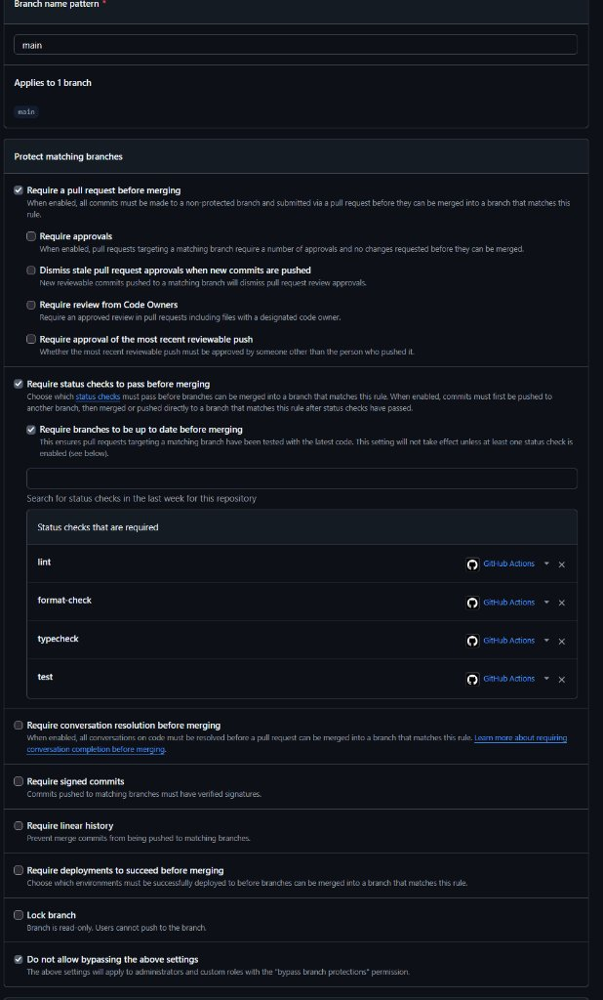

# PA#2 — Harness and Quality Gate Evidence

- **Course:** CSC13114 (`2609-AWAD-23KTPM1`)
- **Product:** AI Travel Planner (Ho Chi Minh City weekend trip schedule & budget planner)
- **Team:** Long Ngô Bảo, Thịnh Nguyễn Đặng Đức, Trần Quốc Thiện
- **Public Repository:** https://github.com/tqthienda1/AI-Travel-Planner
- **Submission Tag:** [`pa2`](https://github.com/tqthienda1/AI-Travel-Planner/tree/pa2) *(applied to the final `main` commit once all team deliverables are merged)*

---

## 1. Repository & One-Command Quality Checks

- **Repository (Public):** https://github.com/tqthienda1/AI-Travel-Planner
- **Workflow & Config:** [`.github/workflows/ci.yml`](.github/workflows/ci.yml), [`package.json`](package.json), [`README.md`](README.md)
- **Initial Scaffold & Check Standardization (`KAN-5`):** [PR #1](https://github.com/tqthienda1/AI-Travel-Planner/pull/1) (`4a2c4e4`)

Every quality check runs with the exact same documented command locally and in GitHub Actions CI:

| Check | Command | CI Job |
|---|---|---|
| Lint | `pnpm lint` | `lint` |
| Format check | `pnpm format:check` | `format-check` |
| Type check | `pnpm typecheck` | `typecheck` |
| Tests & security scan | `pnpm test` | `test` (with `fetch-depth: 0`) |

---

## 2. Protected `main` Branch Settings

- **Branch Protection Settings Page:** https://github.com/tqthienda1/AI-Travel-Planner/settings/branches
- **Screenshot Evidence (`KAN-6`):** [`docs/evidence/branch-protection.jpg`](docs/evidence/branch-protection.jpg) ([GitHub blob](https://github.com/tqthienda1/AI-Travel-Planner/blob/main/docs/evidence/branch-protection.jpg), added in [PR #4](https://github.com/tqthienda1/AI-Travel-Planner/pull/4))

Active Classic Branch Protection rules on `main`:

- **Require a pull request before merging:** enabled (`required_approving_review_count: 0`, zero direct pushes to `main` since protection was enabled).
- **Require status checks to pass before merging:** enabled with **Require branches to be up to date before merging** (`strict: true`) and all 4 CI jobs required: `lint`, `format-check`, `typecheck`, `test`.
- **Do not allow bypassing the above settings:** enabled (`enforce_admins: true`).
- **Force pushes & branch deletions:** disabled (`allow_force_pushes: false`, `allow_deletions: false`).

---

## 3. Blocked PR (Red Check) & Fix Commit (Green Check)

To prove the required CI gate blocks merging on `main` (`KAN-6`):

- **CI Setup PR (Merged):** [PR #2](https://github.com/tqthienda1/AI-Travel-Planner/pull/2)
  - PR CI Run (Green): https://github.com/tqthienda1/AI-Travel-Planner/actions/runs/45649785218
  - `main` Push CI Run (Green): https://github.com/tqthienda1/AI-Travel-Planner/actions/runs/45649930711
- **Blocked Pull Request:** [PR #3 — `feat(KAN-6): parse and validate API server config (Blocked PR demo)`](https://github.com/tqthienda1/AI-Travel-Planner/pull/3)
  - **Failing Commit (deliberate `lint`, `typecheck`, and `test` violations):** [`d2717558adc1c82347e3d82d0e0bbf1a922c70db`](https://github.com/tqthienda1/AI-Travel-Planner/commit/d2717558adc1c82347e3d82d0e0bbf1a922c70db)
  - **Red CI Run (`mergeStateStatus: BLOCKED`):** https://github.com/tqthienda1/AI-Travel-Planner/actions/runs/45650169855 (`lint`, `typecheck`, and `test` failed; merge button blocked by Branch Protection)
- **Fix Commit (turned CI green without editing tests):** [`a541f32c7db7b827a4df069a32f39de94d37457b`](https://github.com/tqthienda1/AI-Travel-Planner/commit/a541f32c7db7b827a4df069a32f39de94d37457b) (modified only `apps/api/src/config.ts`)
  - **Green CI Run (4/4 required checks passed):** https://github.com/tqthienda1/AI-Travel-Planner/actions/runs/45650304151
  - **Merge Commit on `main`:** [`5c02ddf77d1066424e64e96dfcb58729bf3bd3d5`](https://github.com/tqthienda1/AI-Travel-Planner/commit/5c02ddf77d1066424e64e96dfcb58729bf3bd3d5)
  - **`main` Push CI Run (Green):** https://github.com/tqthienda1/AI-Travel-Planner/actions/runs/45650685392

---

## 4. Endpoint Contract, Contract Tests & Deliberate Contract Break

- **Endpoint Contract (`KAN-11`):** [`docs/contract/post-plans-save.md`](docs/contract/post-plans-save.md) (`POST /plans/{planId}/save`, v1.0.0) — [PR #5](https://github.com/tqthienda1/AI-Travel-Planner/pull/5) (CI Run: https://github.com/tqthienda1/AI-Travel-Planner/actions/runs/45653208763)
- **Minimal Endpoint & 23 Contract Tests (`KAN-12`):** [`apps/api/src/plans-save/`](apps/api/src/plans-save/) & [`apps/api/tests/contract/post-plans-save.test.ts`](apps/api/tests/contract/post-plans-save.test.ts) — [PR #8](https://github.com/tqthienda1/AI-Travel-Planner/pull/8) (Green CI Run: https://github.com/tqthienda1/AI-Travel-Planner/actions/runs/45657226023)
- **Deliberate Contract Break (`KAN-13`):** [PR #10 — `chore(KAN-13): deliberate contract break on ownership rule and RFC 9457 problem type`](https://github.com/tqthienda1/AI-Travel-Planner/pull/10)
  - **Contract-Breaking Commit (code-only break in `apps/api/src/plans-save/route.ts`, test file untouched):** [`ae6f47b56b38828c9fe16eecd7cb55a98676766b`](https://github.com/tqthienda1/AI-Travel-Planner/commit/ae6f47b56b38828c9fe16eecd7cb55a98676766b)
  - **Red CI Runs (Contract tests failed and blocked merge):**
    - https://github.com/tqthienda1/AI-Travel-Planner/actions/runs/45657450555
    - https://github.com/tqthienda1/AI-Travel-Planner/actions/runs/45657558258
  - **Code-Only Fix Commit (restored ownership check & RFC 9457 `ownership-violation` type in `route.ts`, tests untouched):** [`8ca561b8e00dca5cce15c1ec225d731f34c0b487`](https://github.com/tqthienda1/AI-Travel-Planner/commit/8ca561b8e00dca5cce15c1ec225d731f34c0b487)
  - **Green CI Run (4/4 required checks passed):** https://github.com/tqthienda1/AI-Travel-Planner/actions/runs/45657847229
  - **Merge Commit on `main`:** [`c6d28fa075949891de66c8b28097356c34f84145`](https://github.com/tqthienda1/AI-Travel-Planner/commit/c6d28fa075949891de66c8b28097356c34f84145)
  - **Red & Green CI Screenshot Evidence:** [`docs/evidence/kan-13-red-ci_1.png`](docs/evidence/kan-13-red-ci_1.png), [`docs/evidence/kan-13-red-ci_2.png`](docs/evidence/kan-13-red-ci_2.png), [`docs/evidence/kan-13-green-ci.png`](docs/evidence/kan-13-green-ci.png) ([PR #11](https://github.com/tqthienda1/AI-Travel-Planner/pull/11))

---

## 5. CI Run for Tag `pa2`

- **Tag Ref:** https://github.com/tqthienda1/AI-Travel-Planner/tree/pa2
- **CI Workflow Runs for Tag `pa2`:** https://github.com/tqthienda1/AI-Travel-Planner/actions/workflows/ci.yml?query=branch%3Apa2

[`.github/workflows/ci.yml`](.github/workflows/ci.yml) triggers on `push.tags: ["*"]`. Pushing tag `pa2` on the final submission commit executes all 4 jobs (`lint`, `format-check`, `typecheck`, `test`) on that exact tagged commit, accessible directly at the workflow query link above.

---

## 6. Rules, Permissions, Security & AI Log Deliverables

- **Rules File (`KAN-8`):** [`AGENTS.md`](AGENTS.md) ([PR #9](https://github.com/tqthienda1/AI-Travel-Planner/pull/9), CI Run: https://github.com/tqthienda1/AI-Travel-Planner/actions/runs/45657429618)
- **Permissions, Secrets & Scanner (`KAN-9`):** [`docs/permissions.md`](docs/permissions.md), [`docs/security.md`](docs/security.md), [`.env.example`](.env.example), [`.gitignore`](.gitignore), [`scripts/scan-secrets.mjs`](scripts/scan-secrets.mjs), [`tests/security/scan-secrets.test.mjs`](tests/security/scan-secrets.test.mjs) ([PR #6](https://github.com/tqthienda1/AI-Travel-Planner/pull/6), CI Run: https://github.com/tqthienda1/AI-Travel-Planner/actions/runs/45654519535)
- **AI Assistance Log (`KAN-10` + team updates):** [`AI-LOG.md`](AI-LOG.md) ([PR #7](https://github.com/tqthienda1/AI-Travel-Planner/pull/7), CI Run: https://github.com/tqthienda1/AI-Travel-Planner/actions/runs/45656137879)
- **Self-Assessment Report (`KAN-7`):** [`SELF_ASSESSMENT_REPORT.md`](SELF_ASSESSMENT_REPORT.md)
